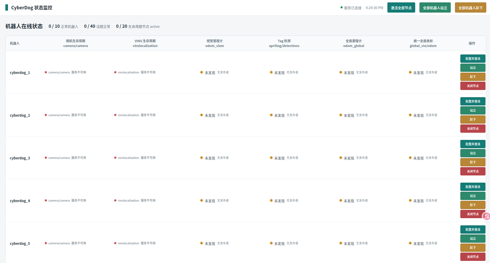

# CyberDog 状态检测网页端使用说明

## 1. 功能概述

`robot_status_web` 在 PC 端启动一个 ROS 2 节点和网页服务，用于集中查看多台 CyberDog 的基础状态，并通过网页执行常用操作。

默认监控 `cyberdog_1` 至 `cyberdog_10`，每台机器人显示：

- 相机生命周期节点：`camera/camera`；
- VINS 生命周期节点：`vinslocalization`；
- 视觉里程计：`/{namespace}/odom_slam`；
- Tag 检测：`/{namespace}/apriltag/detections`（兼容旧版全局 `/detections`）；
- 全局里程计：`/{namespace}/odom_global`（兼容旧版全局 `/odom_global`）；
- 统一全局坐标里程计：`/global_vio/{namespace}/odom`。

网页还支持单台或全部机器人：

- 配置并激活相机和 VINS；
- 关闭相机和 VINS；
- 发送站立指令；
- 发送趴下指令。

> 这是一个运维控制页面。站立、趴下和生命周期切换会直接调用机器人服务，请确认目标机器人和现场安全条件后再操作。

## 2. 运行环境

网页服务应运行在能够通过 ROS 2 DDS 发现机器狗话题和服务的 PC（或容器）中。需要：

- ROS 2 Galactic；
- `rmw_cyclonedds_cpp`；
- 与多机通信一致的 CycloneDDS 配置（工作区根目录或用户目录下的 `.cyclonedds.xml`）；
- 已安装并可被 ROS 2 找到的 `apriltag_msgs`、`protocol` 等工作区依赖。

## 3. 安装、编译与启动

在工作区根目录 `/home/lee/code/cyberdog2_pc_ws` 启动docker，编译代码：

```bash
colcon build --packages-up-to robot_status_web
```

启动网页服务：

```bash
bash src/env/start_robot_status_web.sh
```

启动脚本默认设置DDS相关配置：

- `ROS_DOMAIN_ID=42`；
- `RMW_IMPLEMENTATION=rmw_cyclonedds_cpp`；
- 优先使用工作区 `.cyclonedds.xml`，其次使用 `$HOME/.cyclonedds.xml`；
- 监听 `0.0.0.0:8080`。

浏览器访问：

```text
http://<PC_IP>:8080/
```

本机访问可使用 `http://127.0.0.1:8080/`。不要把 `0.0.0.0` 当作其他设备访问时的目标地址，应改用运行服务的 PC 的实际 IP。

使用自定义参数文件：

```bash
ROBOT_STATUS_CONFIG=/path/to/robot_status_web.yaml \
  bash src/env/start_robot_status_web.sh
```


## 4. 页面说明



### 4.1 顶部状态

- **服务已连接/连接断开**：网页与后端 WebSocket 的连接状态。断开后页面会自动重连。
- **最后更新时间**：后端最近一次推送状态的时间。
- **正常机器人**：同时满足 4 个监控话题为 `healthy` 且两个生命周期节点为 `ACTIVE` 的机器人数量。
- **话题正常**：所有机器人 4 类话题中被判定为 `healthy` 的数量。
- **生命周期节点 active**：所有机器人中处于 `ACTIVE` 的相机和 VINS 节点数量。

### 4.2 状态颜色和含义

话题列显示消息频率；Tag 列还显示最近一帧中的 Tag 数量。`正常` 表示 ROS 2 图中发现该话题的发布者，并且网页已收到过消息。`未发现` 表示没有发现发布者，或依赖的相机/VINS 尚未同时处于 `ACTIVE`。

生命周期状态包括：

| 页面状态 | 含义 |
| --- | --- |
| `ACTIVE` | 节点已激活 |
| `INACTIVE` | 已配置但未激活 |
| `UNCONFIGURED` | 未配置 |
| `服务不可用` | 机器人未启动，无法访问 `get_state` 服务 |
| `错误` | 查询服务调用异常 |
| `FINALIZED` | 节点已终止 |
| `ACTIVATING` / `CONFIGURING` | 节点正在切换状态 |

网页通过 WebSocket 接收实时状态；也可用浏览器或命令行读取 `GET /api/status` 获取当前 JSON 状态。

## 5. 页面操作

### 5.1 配置并激活

点击机器人所在行的 **配置并激活**，后端按以下顺序执行：

1. 将 `camera/camera` 配置并激活；
2. 调用 `camera/realsense_frame_service`，请求开启相机帧服务；
3. 将 `vinslocalization` 配置并激活。

如果节点已经是 `ACTIVE`，对应步骤会跳过。页面会等待状态刷新，直到两个节点都显示 `ACTIVE`。点击顶部 **激活全部节点** 会并行对配置中的所有机器人执行同样流程。

### 5.2 关闭节点

点击 **关闭节点** 后，后端先对 VINS、再对相机执行 `deactivate -> cleanup`，目标状态为 `UNCONFIGURED`。顶部没有“全部关闭”按钮，如需批量关闭请逐行操作。

### 5.3 站立和趴下

- **站立**：调用 `/{namespace}/motion_result_cmd`，发送 motion id `111`；
- **趴下**：调用同一服务，发送 motion id `101`；
- 顶部 **全部机器人站立/趴下** 会并行向所有配置机器人发送指令。

操作结果和失败原因会写入页面底部的**操作日志**。常见失败原因包括服务不可用、motion manager 未激活、正在执行其他动作和低电量保护。

## 6. 配置参数

默认配置文件：`src/src/robot_status_web/config/robot_status_web.yaml`。

| 参数 | 默认值 | 说明 |
| --- | --- | --- |
| `robot_namespaces` | `cyberdog_1` ... `cyberdog_10` | 监控的机器人命名空间列表 |
| `bind_host` | `0.0.0.0` | HTTP 服务监听地址 |
| `bind_port` | `8080` | HTTP/WebSocket 端口 |
| `status_publish_period_sec` | `1.0` | 状态推送周期 |
| `lifecycle_poll_period_sec` | `5.0` | 生命周期查询周期 |
| `*_timeout_sec` | 见配置文件 | 后端预留的话题超时参数；当前网页的“正常/未发现”主要依据发布者发现和消息接收情况 |

修改命名空间时必须与实际 ROS 2 话题、服务命名一致。修改端口后，浏览器访问地址也要同步修改。

## 7. HTTP 接口

接口由网页内部调用，调试时可直接使用：

| 方法 | 路径 | 作用 |
| --- | --- | --- |
| `GET` | `/api/status` | 获取全部机器人状态 |
| `POST` | `/api/robots/{namespace}/activate` | 激活单台机器人 |
| `POST` | `/api/robots/{namespace}/deactivate` | 关闭单台机器人节点 |
| `POST` | `/api/robots/{namespace}/stand` | 单台站立 |
| `POST` | `/api/robots/{namespace}/down` | 单台趴下 |
| `POST` | `/api/activate-all` | 全部激活 |
| `POST` | `/api/stand-all` | 全部站立 |
| `POST` | `/api/down-all` | 全部趴下 |
| `WebSocket` | `/ws` | 实时推送状态 |

示例：

```bash
curl http://127.0.0.1:8080/api/status
curl -X POST http://127.0.0.1:8080/api/robots/cyberdog_1/stand
```

## 8. 故障排查

### 网页无法打开

1. 查看启动终端是否提示找不到 `robot_status_web`；若有，重新执行 `source install/setup.bash` 和 `colcon build --packages-up-to robot_status_web`。
2. 确认防火墙放行配置端口（默认 `8080`），并使用 PC 实际 IP 访问。
3. 检查是否已有其他进程占用端口，或通过 `bind_port` 修改端口。

### 网页可打开但全部显示“未发现”

1. 在同一终端确认已 source ROS 2 和工作区环境。
2. 确认 PC 与机器人使用相同的 `ROS_DOMAIN_ID`、DDS 实现和 CycloneDDS 配置。
3. 使用 `ros2 topic list`、`ros2 topic info <topic>` 检查话题是否可发现。
4. 检查配置中的命名空间是否与实际话题一致，例如 `/{namespace}/odom_slam`。

### 生命周期显示“服务不可用”或激活失败

确认以下服务存在且可调用：

```bash
ros2 service list | grep -E 'camera/(camera/)?(get_state|change_state)|vinslocalization/(get_state|change_state)'
ros2 service list | grep realsense_frame_service
```

如果相机启动失败，VINS 激活会被跳过；请先处理相机节点或相机帧服务问题，再重试。

### 站立/趴下失败

确认 `/{namespace}/motion_result_cmd` 存在，机器人 motion manager 已激活且没有执行其他动作。低电量保护触发时，服务会拒绝动作，具体原因可在操作日志查看。

### 停止服务

在启动终端按 `Ctrl+C`，会同时停止网页服务和 ROS 2 监控节点。
