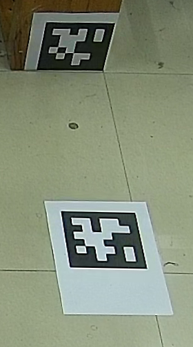

# visual_detection 视觉检测使用说明

## 1. 功能概述

`visual_detection` 是基于 YOLOv8 ONNX Runtime 的 ROS 2 Galactic 视觉检测功能包，可从 RTSP 网络摄像头或 ROS 图像话题读取图像，识别以下类别：

| 类别 ID | 类别名 |
| ---: | --- |
| 2 | `soccer` |
| 3 | `goal` |

节点输出目标中心的图像像素坐标、检测置信度和以球门中心为原点的相对坐标。足球还会输出检测框底边中心，可供场地平面坐标转换使用。功能包同时提供：

- `visual_detection_node`：ROS 2 实时检测节点；
- `soccer_global_converter`：结合场地 Tag1 将足球像素位置转换为 `tag_global` 坐标；

## 2. 环境与编译

建议在项目提供的 ROS 2 Galactic 容器中运行：

```bash
docker exec -it galactic_onnx_gpu bash
```

运行环境需要具备：

- ROS 2 Galactic、OpenCV、`cv_bridge`；
- ONNX Runtime C++ SDK，且 GPU 模式可用 CUDA/TensorRT provider；
- muduo（TCP 服务端/客户端使用）。

在工作区根目录执行：

```bash
source /opt/ros/galactic/setup.bash
colcon build --packages-select visual_detection --symlink-install
source install/setup.bash
```

如果 CMake 找不到 ONNX Runtime，需要设置 `ONNXRUNTIME_ROOT` 或 `ONNXRUNTIME_DIR` 指向包含 `include/` 和 `lib/` 的 ONNX Runtime 目录。找不到 muduo 时需安装 muduo，或将其库路径加入 `CMAKE_PREFIX_PATH`/`LD_LIBRARY_PATH`。

模型和类别文件会随功能包安装：

- `install/visual_detection/share/visual_detection/models/best.onnx`；
- `install/visual_detection/share/visual_detection/data.yaml`。

## 3. ROS 2 实时检测

默认配置文件为 `src/src/visual_detection/config/visual_detection.yaml`。加载环境后运行：

```bash
source /opt/ros/galactic/setup.bash
source install/setup.bash
ros2 run visual_detection visual_detection_node
```

节点会连接配置中的 RTSP 地址，读取最新帧，执行 ONNX 推理，并发布检测结果。启动日志正常时应包含：

```text
RTSP stream connected
RTSP detection enabled
```


当前配置中的主要参数如下：

| 参数 | 默认/当前值 | 说明 |
| --- | --- | --- |
| `video_stream` | 配置文件中的 RTSP URL | 为空时使用 ROS 图像话题 |
| `image_topic` | `/image_raw` | ROS 图像输入话题 |
| `model_path` | 包内 `models/best.onnx` | YOLOv8 ONNX 模型 |
| `labels_path` | 包内 `data.yaml` | 类别名称文件 |
| `device` | `cuda` | 可改为 `cpu` |
| `cuda_device_id` | `0` | CUDA 设备编号 |
| `confidence_threshold` | `0.25` | 置信度阈值 |
| `nms_threshold` | `0.45` | NMS 阈值 |
| `preview` | 以 YAML 为准 | 是否显示 OpenCV 预览 |
| `max_grab_frames` | `8` | 每轮最多丢弃的旧帧数 |
| `ffmpeg_capture_options` | TCP/低延迟 | OpenCV FFmpeg 拉流选项 |

预览窗口名为 `visual_detection`，画面会显示检测框、类别、置信度、球门原点、目标点和足球预测点。按 `Esc` 可请求关闭节点。

## 4. ROS 输出话题

### 4.1 完整 JSON

话题：`/visual_detection/result`，类型：`std_msgs/msg/String`。

```bash
ros2 topic echo /visual_detection/result
```

单帧 JSON 主要字段：

| 字段 | 含义 |
| --- | --- |
| `frame_index` | 帧序号 |
| `timestamp_sec` | 时间戳，单位秒 |
| `goal_origin` | 球门中心的图像坐标；没有可用球门时为 `null` |
| `points` | 当前帧目标点数组 |
| `class_id` / `class_name` | 类别编号和名称 |
| `confidence` | 检测置信度 |
| `image_point` | 目标中心像素坐标 |
| `goal_relative_point` | 以球门中心为原点的相对像素坐标，x 向右为正、y 向上为正 |
| `predicted` | 足球点是否来自短时轨迹预测 |

球门漏检时，`goal_origin` 可能为空，但足球和机器狗仍可能出现在 `points` 中；此时对应的球门相对坐标不应作为有效球门参考使用。

### 4.2 分类目标位置

以下话题类型均为 `geometry_msgs/msg/PointStamped`：

```text
/visual_detection/soccer
/visual_detection/soccer_ground_contact
/visual_detection/goal
/visual_detection/dog1
/visual_detection/dog2
```

字段含义：

```text
point.x       图像像素 x
point.y       图像像素 y
point.z       检测置信度
header.frame_id = image
```

其中：

- `/visual_detection/soccer` 是足球框中心；
- `/visual_detection/soccer_ground_contact` 是足球检测框底边中心，更适合投影到地面；
- 某类别在当前帧没有检测到时，该类别通常不会发布消息；
- 足球短时漏检时 tracker 最多预测 15 个处理帧，超过后停止发布，避免无限外推。

检查示例：

```bash
ros2 topic hz /visual_detection/soccer
ros2 topic echo /visual_detection/goal
ros2 topic echo /visual_detection/soccer_ground_contact
```

### 4.3 场地相机图像和内参

RTSP 模式下，节点还会发布经过畸变校正的图像和相机内参：

```text
/field_camera/image_rect       sensor_msgs/msg/Image
/field_camera/camera_info      sensor_msgs/msg/CameraInfo
```

`camera_fx/fy/cx/cy` 必须对应 RTSP 实际输出分辨率；`camera_distortion` 顺序为 OpenCV `plumb_bob` 的 `k1,k2,p1,p2,k3`。同一校正帧用于 YOLO 和 AprilTag，可保证像素坐标一致。

## 5. 足球全局坐标转换

该功能需要三部分同时运行：视觉检测、AprilTag 场地 Tag1 检测、`soccer_global_converter`。

### 5.1 标定参数

配置文件：`src/src/visual_detection/config/convert.yaml`。

使用前核对：

- `tag_family`、`tag_id`、`tag_size_m` 与实际 Tag1 一致；
- `tag1_in_tag_global` 填写 Tag1 在最终 `tag_global` 坐标系中的实测三维平移和四元数（顺序 `qx,qy,qz,qw`）；
- `ground_z_m` 与场地地面高度一致；
- `output_axis_mapping` 是坐标分量重排，不是 TF 刚体旋转，用于和机器人全局坐标进行统一；
- `camera_fx/fy/cx/cy` 和畸变参数已按当前分辨率标定；
- `calibration_valid` 只有在实测参数完成并核验坐标轴后才设为 `true`。

Tag码布置示意如下所示，Tag0 垂直放置，用于机器人识别，Tag1 布置在水平地面上，用于场地摄像头识别，二者相对位置设置到tag1_in_tag_global参数中



### 5.2 启动顺序

终端 1，启动视觉检测：

```bash
ros2 run visual_detection visual_detection_node --ros-args \
  --params-file install/visual_detection/share/visual_detection/config/visual_detection.yaml
```

终端 2，启动 AprilTag，并将输入输出重映射到场地话题：

```bash
ros2 run apriltag_ros apriltag_node --ros-args \
  -r image_rect:=/field_camera/image_rect \
  -r camera_info:=/field_camera/camera_info \
  -r detections:=/field_camera/tag_detections \
  --params-file install/visual_detection/share/visual_detection/config/apriltag_field_camera.yaml
```

终端 3，启动全局坐标转换：

```bash
ros2 run visual_detection soccer_global_converter --ros-args \
  --params-file install/visual_detection/share/visual_detection/config/convert.yaml
```

输出：`/field/soccer_global`，类型 `geometry_msgs/msg/PointStamped`，`header.frame_id` 为 `tag_global`，坐标单位为米。该点表示足球接地点在场地平面上的位置，不是足球球心高度。

分段检查：

```bash
ros2 topic hz /field_camera/image_rect
ros2 topic echo --once /field_camera/camera_info
ros2 topic hz /field_camera/tag_detections
ros2 topic echo --once /field_camera/tag_detections
ros2 topic hz /visual_detection/soccer_ground_contact
ros2 topic echo /field/soccer_global
```

在 RViz 中可将 Fixed Frame 设为 `tag_global`，同时显示 `/field/soccer_global` 和其他全局坐标话题，先用多个已知场地点验证坐标和误差，再进行动态测试。

